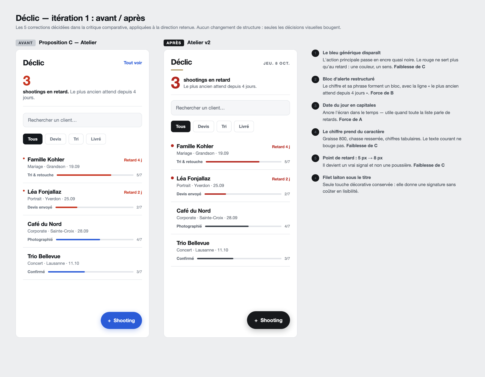

# Itérations du design — Déclic

Le dossier ne s'arrête pas au choix d'une direction. Cette page retrace ce qui a changé après
coup, et **pourquoi** — c'est la seule façon de montrer qu'une décision a été prise plutôt que
subie.

| Itération | Déclenchée par | État |
|---|---|---|
| **v1** | Choix entre les trois propositions | ✅ [critique.md](critique.md) |
| **v2** | Les 5 corrections décidées dans la critique | ✅ ci-dessous |
| **v3** | Les tests utilisateurs | ⏳ en attente — voir [tests.md](tests.md) |

---

## Itération 1 : v1 → v2

La structure ne bouge pas. Seules les décisions visuelles changent — c'est volontaire : la
structure vient du [wireframe](wireframes/wireframe-v1.png), qui n'a pas été remis en cause.

### Les 5 corrections

| # | Correction | Origine | Ce que ça règle |
|---|---|---|---|
| 1 | Le bleu générique devient de l'encre quasi noire | Faiblesse de C | Le bleu ne racontait rien. Surtout, il concurrençait le rouge : deux couleurs vives pour deux sens différents. |
| 2 | Bloc d'alerte restructuré, avec sa deuxième ligne | Force de B | Le chiffre et sa phrase formaient une bouillie typographique ; ils sont maintenant alignés en bloc. |
| 3 | Date du jour en capitales dans l'en-tête | Force de A | Quand toute la liste parle de retards, savoir quel jour on est devient une information utile. |
| 4 | Le grand chiffre prend du caractère | Faiblesse de C | C était la plus lisible mais la plus anonyme. Le chiffre est le seul endroit où j'ajoute de la personnalité, parce qu'il n'y a pas de texte à lire dedans. |
| 5 | Point de retard : 5 px → 8 px | Faiblesse de C | À 5 px, c'était une poussière plutôt qu'un signal. |
| + | Filet laiton sous le titre | — | Seule touche décorative conservée. Elle donne une signature sans rien coûter en lisibilité. |

### La contradiction que cette itération a révélée

En appliquant la correction n°1, je me suis rendu compte que mon propre brief se contredisait.

> **Brief, point 9 (version initiale) :** « une seule couleur d'accent, réservée à l'action
> principale **et** à l'état en retard »
>
> **Critique, correction 1 :** « garder le rouge **uniquement** pour le retard »

Les deux ne peuvent pas être vrais en même temps. **J'ai tranché pour la critique**, parce qu'une
couleur qui signifie à la fois « appuie ici » et « il y a un problème » n'apprend rien à personne :
c'est exactement le défaut que j'avais reproché à la proposition A, où le terracotta marquait
en même temps le retard et l'étape courante.

Le système de couleurs de la v2 est donc :

| Couleur | Rôle | Jamais utilisée pour |
|---|---|---|
| **Encre** `#17191C` | Texte principal, action principale | Signaler un état |
| **Rouge brique** `#B3261E` | Uniquement le retard | Un bouton, un lien, un titre |
| **Gris foncé** `#3A4049` | Progression normale | Du texte |
| **Laiton** `#8A6514` | Un filet décoratif, rien d'autre | Du texte, une icône porteuse de sens |

Le [brief](../brief.md#9-direction-visuelle) a été corrigé en conséquence. **C'est l'itération qui
a corrigé le brief, pas l'inverse** — et c'est normal : on découvre les contradictions en
dessinant, pas en écrivant.

### Vérifié après l'itération

Tous les contrastes de la nouvelle palette ont été recalculés, et aucun ne descend sous 4.5:1 sur
du texte. Le détail est dans [accessibilite.md](accessibilite.md).

---

## Itération 2 : v2 → v3 *(en attente des tests)*

Le protocole est prêt dans [tests.md](tests.md). Tant que les passations ne sont pas faites, cette
section reste vide — **je ne vais pas inventer des résultats pour avoir l'air d'avoir itéré.**

Ce que j'attends des tests, et qui décidera de la v3 :

1. Est-ce que quelqu'un comprend que la ligne entière est cliquable ? (rien ne l'indique
   aujourd'hui — c'est le défaut que j'ai relevé sur les tuiles du site du CPNV pendant le roast)
2. Est-ce que « 5/7 » se comprend sans explication, ou faut-il écrire « étape 5 sur 7 » ?
3. Est-ce que les 3 appuis annoncés dans le brief tiennent vraiment, chronomètre en main ?
